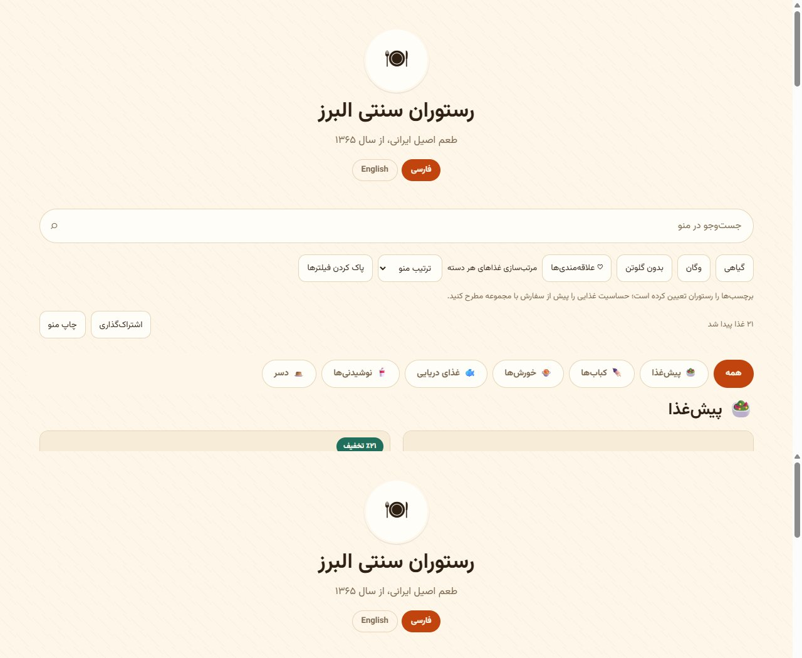

# MenuCraft · منوساز

**A Persian/English digital restaurant menu, built with Go and SQLite.** Create a restaurant, organize dishes, customize its design, and share one public link or a printable QR code.

[راهنمای کامل فارسی](README.fa.md) · [Download releases](https://github.com/unknown-killer/MenuCraft/releases) · [Deployment](docs/DEPLOYMENT.md) · [WordPress](docs/WORDPRESS.md)



## What you can do

- Manage bilingual categories and dishes, prices, discounts, availability, featured dishes, dietary tags, calories and preparation time.
- Choose from **114 appearance presets** and **54 complete menu packs** for restaurants, cafés, fast food, bakeries, juice bars and more; edit every dish and price afterward.
- Customize colors, typography, backgrounds, layout, cards, light/dark mode and custom CSS with a live preview.
- Arrange page sections and custom blocks; use the canvas designer for positioned text, images, buttons, shapes, icons and prices.
- Upload images into a venue-scoped library; configure contact information, opening hours, currency and public slug.
- Search Persian and English simultaneously, normalize Arabic/Persian letter variants, filter dietary tags, save favorites locally, sort prices within categories, share and print.
- Export menu data as portable JSON or spreadsheet-friendly CSV. Import JSON by appending or explicitly replacing categories and dishes.
- Publish in WordPress with the included plugin: a native imported menu or the live Go design in an iframe.

The app has separate owner accounts and per-restaurant data isolation. This is a menu publishing system; it does not process orders, payments, reservations or deliveries.

## Start in a minute

### Windows

Download the Windows ZIP for your CPU from [Releases](https://github.com/unknown-killer/MenuCraft/releases), extract it to a writable folder and double-click **run.bat**. Visit [localhost:8080](http://127.0.0.1:8080), register, and create your menu.

### Linux

Download the Linux archive for your CPU, then:

```sh
tar -xzf menucraft_1.1.0_linux_amd64.tar.gz
cd menucraft_1.1.0_linux_amd64
./run.sh
```

Open [localhost:8080](http://127.0.0.1:8080). The launch scripts bind to loopback by default. For a remote server, follow the [HTTPS deployment guide](docs/DEPLOYMENT.md).

### From source

Requires **Go 1.26.9 or newer**. No Node.js, PHP or C compiler is needed for the Go application.

```sh
go mod download
go run .
```

The direct Go default listens on `:8080`; set `MENU_ADDR=127.0.0.1:8080` for local-only access. Assets, templates and the Vazirmatn font are embedded in release binaries. The app creates its SQLite database, signing key and uploads directory on first run.

Optional local demonstration:

```sh
go run ./cmd/seed
go run .
```

Open `/m/demo`; sign in with `demo` / `Demo1234`. The seed command replaces the selected demo account's menu, so use a disposable development database. Production containers do **not** seed the demo by default.

## First menu

1. Register and select the business type.
2. Add categories/dishes or apply a ready-made menu pack.
3. Adjust prices, availability, contact details and opening hours.
4. Pick a theme, preview both languages and save.
5. Publish in Settings, then share `/m/your-slug` or print `/m/your-slug/qr`.

Draft menus are visible only to their signed-in owner. Favorites stay in the visitor's browser and do not require an account. Dietary labels are entered by the restaurant.

## Configuration

Set environment variables in your shell, service or container. The binary does not automatically load a `.env` file.

| Variable | Default | Purpose |
|---|---|---|
| `MENU_ADDR` | `:8080` | HTTP bind address |
| `MENU_DB` | `data/menu.db` | SQLite file |
| `MENU_UPLOADS` | `uploads` | Uploaded images |
| `MENU_ENV` | `development` | Use `production` behind HTTPS; enables Secure cookies and embedded assets |
| `MENU_PUBLIC_URL` | empty | Canonical origin, e.g. `https://menu.example.com`, for QR/export links |
| `MENU_EMBED_ORIGINS` | empty | Comma-separated exact origins allowed to frame public menus |
| `MENU_DISABLE_REGISTRATION` | `false` | Set `true` after creating owner accounts |
| `MENU_SECRET` | generated | Optional signing secret, at least 32 bytes |
| `MENU_LOCALE` | `fa` | Default language: `fa` or `en` |
| `MENU_MAX_UPLOAD` | `8388608` | Image upload limit in bytes |
| `MENU_SESSION_TTL` | `720h` | Signed session lifetime |

The generated secret is stored as `.secret` beside the database. Keep it persistent along with the database and images. `/healthz` reports process liveness; `/readyz` also checks database connectivity.

## WordPress

Upload `menucraft-wordpress_1.1.0.zip` from the release to **Plugins → Add New → Upload Plugin**, activate it, then open **Settings → MenuCraft**.

- **Native mode:** export JSON from the Go panel, import it in WordPress and add `[menucraft_menu lang="fa"]` or `[menucraft_menu lang="en"]` to a page. It supports bilingual content, responsive cards, prices, search and categories.
- **Live mode:** configure the published Go URL and permit the WordPress origin with `MENU_EMBED_ORIGINS` on the Go server.

Native mode imports a snapshot; it does not reproduce Go themes/canvas or synchronize future edits. Images remain linked to their original host unless moved to WordPress. Live mode requires the Go server to stay online. [Full setup and limitations](docs/WORDPRESS.md).

## Development and release

```sh
go test ./...
go vet ./...
go run golang.org/x/vuln/cmd/govulncheck@v1.9.0 ./...
go run ./cmd/release -version 1.1.0
```

The release command builds Windows/Linux binaries for **amd64 and arm64**, adds launch scripts and documentation, packages the WordPress plugin and writes `dist/SHA256SUMS.txt`. It requires Git and Go with verified module downloads; do not disable the Go checksum database.

Tests cover authentication, CSRF, tenant isolation, private drafts, request limits, atomic registration/import/menu-pack operations, configuration, template rendering and the theme/catalogue engines. See [verification](docs/VERIFICATION.md), [architecture](docs/ARCHITECTURE.md) and [changelog](CHANGELOG.md).

## Data and operations

Menu JSON is a **content transfer format**, not a full backup. It omits accounts, passwords, signing secrets, uploaded image bytes, themes, canvas designs and opening-hours settings. For recovery, back up the database, uploads and signing key together using the [deployment guide](docs/DEPLOYMENT.md).

SQLite is intended for a single server with persistent local storage. Horizontally scaling multiple application instances against a shared file is not supported by this deployment. There is no password-reset email integration; owners can change their password while signed in.

## Attribution

Vazirmatn is bundled under the SIL Open Font License. Go dependencies retain their upstream licenses; see [third-party notices](docs/THIRD_PARTY_NOTICES.md). This repository does not currently declare a license for the application's own source.
